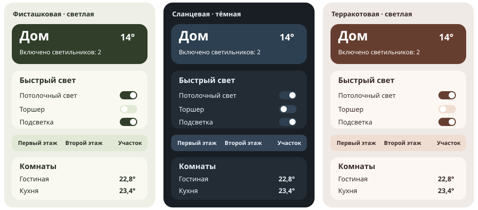

# Home Panel for Home Assistant

Home Panel — кастомный дашборд для Home Assistant с обзором комнат, быстрым светом, климатом и дополнительными разделами. Использует текущий сеанс Home Assistant. Поддерживает четыре палитры, светлый и тёмный режимы, а также переключение по восходу и закату.

## Интерактивное демо

Скачайте репозиторий через **Code → Download ZIP**, распакуйте и откройте `demo/index.html` в браузере. Home Assistant для демо не требуется. Два списка сверху переключают палитру и светлый, тёмный или автоматический режим. Можно открыть комнаты, выключить свет и изменить уставку. Демо использует тот же интерфейс, что и устанавливаемая карточка, с вымышленными устройствами.

## Установка

1. Скачайте `moy-dom.js` и скопируйте его в `/config/www/`.
2. В **Настройки → Панели → меню ⋮ → Ресурсы** добавьте `/local/moy-dom.js` как **Модуль JavaScript**. Если пункта «Ресурсы» нет, включите расширенный режим в профиле администратора.
3. Создайте пустой дашборд. Откройте его редактор, выберите **Текстовый редактор** в меню ⋮ и вставьте готовый [шаблон](examples/automatic.yaml). Менять YAML для автоматического режима не требуется.

Панель использует существующие помещения, этажи и названия из Home Assistant. Свет и климат появляются автоматически, устройства без помещения собираются отдельно. «Ещё» показывает настройки оформления и обнаруженные камеры, охрану, пылесосы и медиаплееры. Быстрый свет выбирает до трёх светильников первой комнаты со светом. Групповое выключение затрагивает только свет выбранной зоны после подтверждения. В автоматическом режиме обычные розетки и переключатели не включаются в группу света.

## Дополнительные настройки

[Полный пример](examples/custom.yaml) показывает, как задать произвольные зоны, порядок комнат и точные привязки.

| Поле карточки | Что задаёт |
| --- | --- |
| `zones` | Список зон с `name` и `rooms`. У комнаты уникальный `id`, `name` и необязательные `lights`, `temperature`, `humidity`, `climate`, `ir`, `details`. |
| `quick_lights` | Пары `[entity_id, подпись]` для главного экрана. Пустой список скрывает блок. |
| `outdoor_temperature` | Датчик уличной температуры. |
| `alerts` | Пары `[binary_sensor, подпись]`; предупреждение видно при состоянии `on`. |
| `more` | Пары `[подпись, entity_id или локальный путь]`. Порядок сохраняется. |

Для технических ссылок нужны обычные права Home Assistant. Камеры, охрана и медиаплееры открывают штатные карточки устройств. Вручную в список света можно добавить реле `switch`. Яркость, режимы и пресеты появляются по возможностям конкретных сущностей.

## Совместимость и обновление

Используйте Home Assistant с редактором дашбордов и актуальный браузер. Автоматическая группировка использует сведения о помещениях, этажах и устройствах, доступные в сеансе. Если они отсутствуют, поддерживаемые сущности отображаются в общей группе. При обновлении замените JS и измените URL ресурса, например на `/local/moy-dom.js?v=2`.

Первая версия проверяется на имитации данных Home Assistant. Матрица версий Home Assistant и мобильных клиентов пока не подтверждена.
